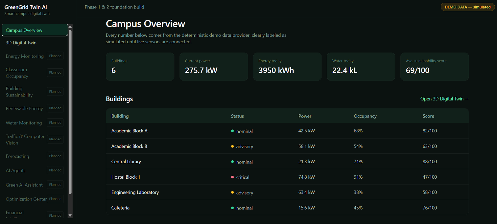
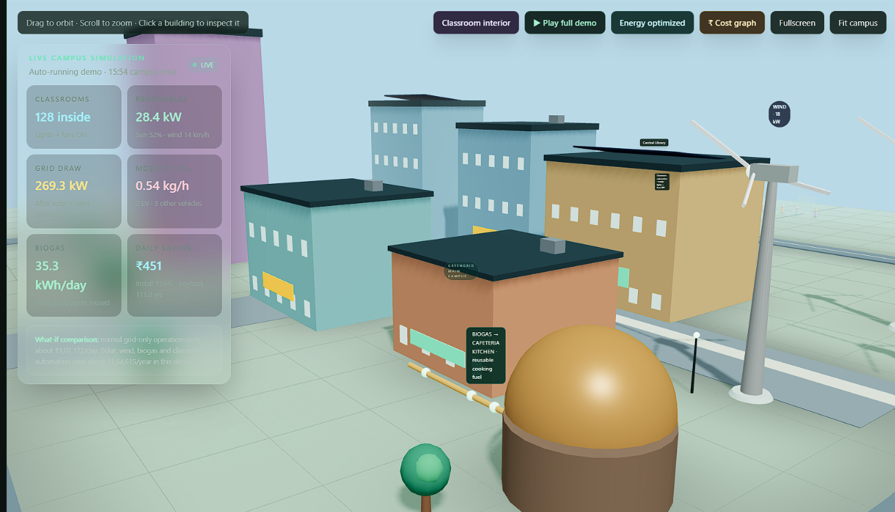
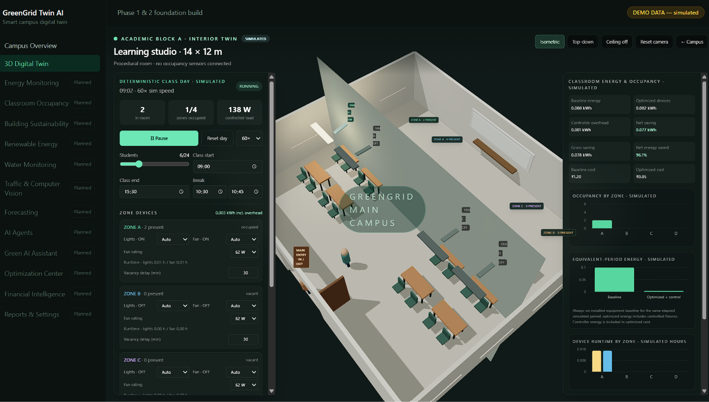
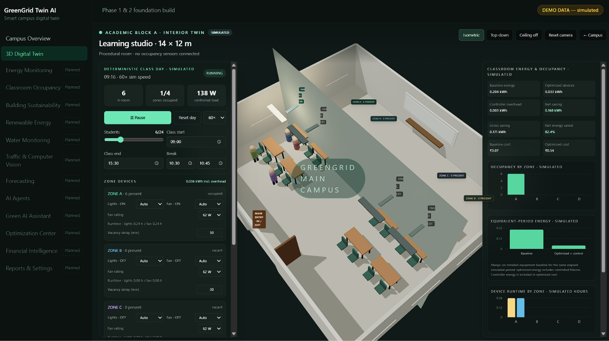
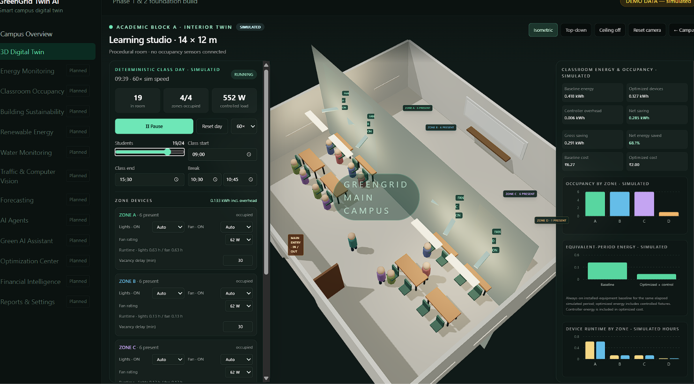
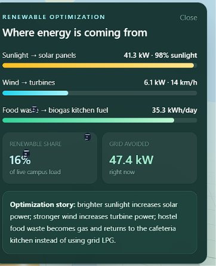
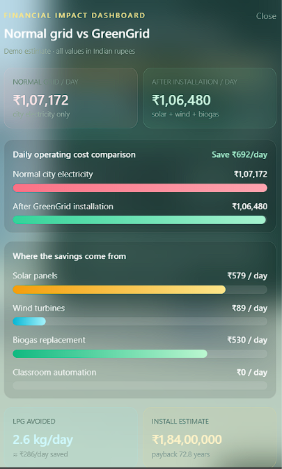
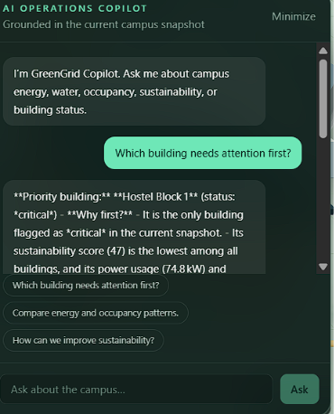
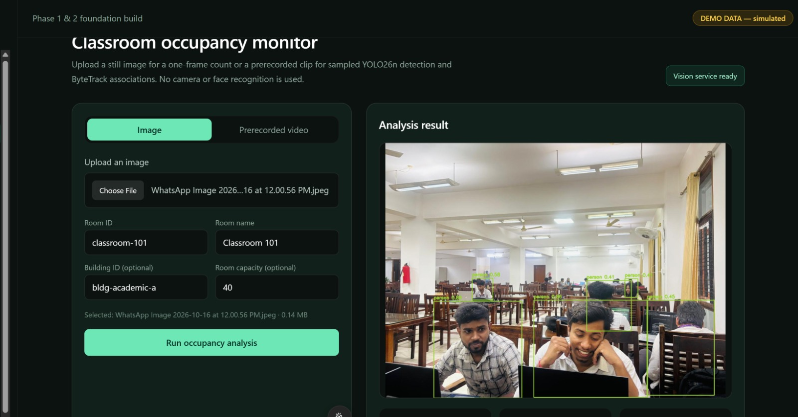

# GreenGrid Twin AI

GreenGrid Twin AI is a smart-campus digital twin demo. It combines a campus dashboard and interactive 3D campus with a simulated classroom interior, an upload-based classroom occupancy workflow, and advisory energy views.

> **Demo data is simulated.** Campus-wide energy, water, cost, mobility, and renewable figures are illustrative. Classroom occupants and classroom energy are produced by a deterministic simulation. Computer-vision occupancy comes from a user-uploaded image or video; it is not a live camera feed.

**Live app:** [greengrid-twin-ai.vercel.app](https://green-grid-twin-ai.vercel.app/) · **3D Digital Twin:** [Open the deployed twin](https://green-grid-twin-ai.vercel.app/twin)

## Screenshots

### Campus overview

The dashboard summarizes six demo buildings and their simulated status, power, occupancy, and sustainability scores.



### Interactive 3D campus

Orbit and zoom around the campus, inspect buildings, and open the classroom interior, renewable view, or cost comparison.



### Classroom interior simulation

The Academic Block A learning studio is a procedural 3D room. The deterministic class-day controls let you set the student count, schedule, break, simulation speed, and device behavior. Zones show simulated occupancy and independently configurable lighting and fan behavior.



As the simulated class progresses, students move between zones and the energy charts update.



A later simulation snapshot shows more occupied zones and their corresponding device runtime.



The classroom energy panel compares an always-on baseline with simulated optimized device use, controller overhead, net savings, occupancy by zone, and device runtime.


The energy summary can also be viewed alongside the classroom.


### Campus energy views

The renewable panel illustrates contributions from sunlight, wind, and biogas.



The cost panel compares a normal grid-only estimate with a GreenGrid scenario and breaks down illustrative savings.



### GreenGrid assistant

The operations copilot answers campus questions using the current campus snapshot. It requires a configured Groq API key on the backend.



### Classroom occupancy from an upload

The occupancy page accepts a still image or prerecorded video and returns person detections and an occupancy summary. In this example, a user-selected classroom photo is annotated with model detections.



## How the workflow works

1. **Explore the campus.** Start at Campus Overview to review the clearly labeled demo snapshot. Open 3D Digital Twin to orbit the campus and inspect a building.
2. **Open the classroom interior.** From the 3D twin, choose **Classroom interior**. The room view is labeled simulated and has no connected occupancy sensors.
3. **Run a class-day simulation.** Choose student count, class and break times, and simulation speed. The simulation moves students through four zones and updates the lights, fans, runtime, and estimated energy charts. You can pause or reset the day, change fan ratings, and set automatic or forced device controls.
4. **Review campus energy panels.** Use the renewable and cost views to explore illustrative solar, wind, biogas, and cost scenarios. These values are estimates, not utility readings or bills.
5. **Analyze classroom occupancy (optional).** Open **Classroom Occupancy**, choose **Image** or **Prerecorded video**, select a file, enter a room ID and name, and optionally add a building ID and room capacity. Start the analysis to submit the file to the FastAPI service.
6. **Review the result.** YOLO26n detects people in an image or sampled video frames. Video analysis uses ByteTrack to associate detections between sampled frames. The app reports a count, quality, status, and recommendation, then stores the latest room snapshot in backend memory. If a building ID was supplied, the snapshot can appear in that building's detail panel.
7. **Use the assistant.** Ask about the campus snapshot in the copilot. It requires `GROQ_API_KEY` configured as a Render backend environment secret.

### Occupancy safety and limits

- No live camera stream is accessed. Users choose and upload still images or prerecorded clips.
- Face recognition and identity matching are not implemented. Tracking IDs in video are temporary associations, not identities.
- A single image cannot confirm an empty room. Empty-room and energy recommendations require sufficiently reliable, sustained evidence.
- Upload-derived occupancy snapshots are held in memory and can be lost when the service restarts or spins down.
- Classroom schedules, zone occupancy, device states, classroom energy, and campus-wide metrics remain simulated; no equipment is controlled.
- The configured upload limits are 50 MB per file and up to 120 seconds of video.

## Features

- **Campus dashboard:** six deterministic demo buildings, status, power, energy, water, occupancy, and sustainability summaries.
- **3D digital twin:** interactive campus scene, building inspection, and a guided tour.
- **Classroom interior:** four-zone procedural room, scheduled student movement, device controls, and classroom energy charts.
- **Computer-vision occupancy:** image/video upload, YOLO26n person detection, sampled video analysis with ByteTrack, room snapshots, and advisory recommendations.
- **Energy calculations:** hypothetical savings estimates from provided device ratings and operating schedules.
- **Operations copilot:** campus Q&A through Groq when a backend API key is configured.

## Run locally

### Backend

Requires Python 3.11 or later.

```bash
cd backend
python -m venv .venv
# Windows:
.venv\Scripts\activate
# macOS/Linux:
# source .venv/bin/activate
pip install -r requirements-cpu.txt
cp .env.example .env
uvicorn app.main:app --reload --port 8000
```

The vision model weights download lazily on the first inference. Open [http://localhost:8000/docs](http://localhost:8000/docs) for API documentation. Health check: `/api/v1/health`.

### Frontend

In a second terminal:

```bash
cd frontend
npm install
cp .env.example .env.local
npm run dev
```

Open [http://localhost:3000](http://localhost:3000). The frontend API base URL is set with `NEXT_PUBLIC_API_BASE_URL` in `frontend/.env.local`; point it at the backend, for example `http://localhost:8000`.

For the assistant, set `GROQ_API_KEY` in the backend environment. Never put provider keys in frontend variables or commit them to Git.

## Deployment

- **Frontend:** Vercel, with the project root set to `frontend`.
- **Backend:** Render web service defined in `render.yaml`, using `backend/requirements-cpu.txt` and health check `/api/v1/health`.
- Set the Vercel `NEXT_PUBLIC_API_BASE_URL` to the Render service URL.
- Set Render `FRONTEND_ORIGIN` to the deployed frontend origin. Add `GROQ_API_KEY` in Render's environment settings if you want the copilot enabled.
- Render's free service can spin down when idle; the first request after inactivity may take longer. Computer-vision inference also needs enough available memory and CPU on the selected service plan.

## Repository layout

```
backend/        FastAPI API, demo data, classroom occupancy and energy services
frontend/       Next.js dashboard, 3D twin, classroom interior, occupancy UI
docs/images/    Screenshots used in this README
docs/           Architecture, deployment, and feature notes
render.yaml     Render backend service configuration
HANDOFF.md      Development handoff notes
```

## API overview

- `GET /api/v1/health` — backend status
- `GET /api/v1/campus` — demo campus snapshot
- `GET /api/v1/vision/status` — vision model availability
- `POST /api/v1/vision/detect-image` — analyze a still image
- `POST /api/v1/vision/analyze-video` — queue a prerecorded video analysis
- `GET /api/v1/vision/jobs/{job_id}` — read video-job status and result
- `GET /api/v1/occupancy/rooms` — list in-memory occupancy snapshots
- `GET /api/v1/energy/recommendations` — advisory room recommendations

See [docs/VISION_OCCUPANCY.md](docs/VISION_OCCUPANCY.md), [docs/DEPLOYMENT.md](docs/DEPLOYMENT.md), and [docs/ARCHITECTURE.md](docs/ARCHITECTURE.md) for more detail.
